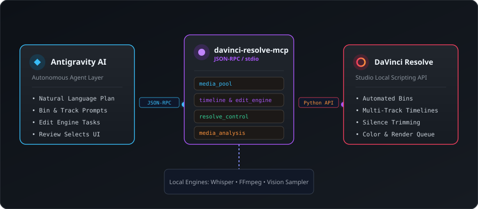

Here's something that's been saving me a ton of time: connecting [Antigravity](/posts/2026-06-03-antigravity-flutter-setup/) directly to [DaVinci Resolve Studio](https://www.blackmagicdesign.com/products/davinciresolve) so the agent can organize media, build timelines, and strip dead air before I ever touch the UI.

The piece that makes it possible is [davinci-resolve-mcp](https://github.com/samuelgursky/davinci-resolve-mcp), an open-source server built on Anthropic's [Model Context Protocol (MCP)](https://modelcontextprotocol.io/) that exposes Resolve's scripting API as executable tools for autonomous AI agents. Once wired up, you describe the edit goals in natural language and the agent handles repetitive assembly.

{: .align-center style="max-width: 100%; border-radius: 12px; margin: 2rem auto; display: block;"}
*Architecture: Antigravity AI orchestrates DaVinci Resolve Studio through davinci-resolve-mcp via local JSON-RPC and scripting APIs.*

---

## 1. One-Time Setup (Under 3 Minutes)

### Enable External Scripting in Resolve

Open **DaVinci Resolve Studio**, go to **Preferences > System > General**, and set **External scripting using** to **Local**.

If you're on Resolve 21+, you can also go to **File > Setup AI Assistants > Antigravity** to enable it from there.

### Install the MCP Server

With Resolve open, run the interactive installer:

```bash
npx davinci-resolve-mcp setup
```

It auto-detects Antigravity and writes the server config to:

```
~/.gemini/antigravity/mcp_config.json
```

or if you use the global config path:

```
~/.gemini/config/mcp_config.json
```

### Verify the Connection

Restart Antigravity, then run a quick health check:

```bash
npx davinci-resolve-mcp doctor
```

Or ask the agent directly:

```
Run resolve_control(action="get_version") and tell me if it connected successfully.
```

If it comes back with your Resolve version number, you're good.

---

## 2. Three Workflows Worth Setting Up

### Bin and Timeline Scaffolding

Creating the same folder structure and track layout for every project is mindless work. Tell the agent to do it:

```
Scan my footage in ./raw_footage, build a Media Pool bin structure with folders for RAW_VIDEO, AUDIO_ASSETS, and TIMELINES, then create a 24fps timeline called "Master_Edit" with 3 video tracks (V1_A_Roll, V2_B_Roll, V3_Titles) and 3 audio tracks (A1_Dialogue, A2_Music, A3_SFX). Add color-coded chapter markers at the timecodes I'll give you.
```

The agent uses `media_pool` and `timeline` MCP tools to build this out without you clicking around.

### Batch Clip Analysis Before You Cut

Before pulling anything into the timeline, have the agent analyze your raw clips first. Open the control panel dashboard:

```
Run resolve_control(action="open_control_panel") and open the local dashboard.
```

Then kick off transcription and visual analysis on your raw footage:

```
Run media_analysis on 01_RAW_VIDEO with transcription and vision enabled. Tag selects with I and rejects with X based on the transcript and visual quality.
```

This runs local Whisper on the dialogue and samples frames without touching your camera originals. You review selects in the browser at `http://127.0.0.1:8765` before anything goes into the timeline.

### Dead-Air Removal and B-Roll Assembly

Once you've reviewed selects, you can have the agent plan the rough cut:

```
Use edit_engine(action="plan_tighten") to find and cut silent pauses below -45dB in the dialogue clips. Then use plan_selects to layer B-roll clips onto V2 (video-only, no audio) so the scratch audio on the camera clips stays untouched.
```

Every timeline change saves a snapshot in the Control Panel's Timeline History, so you can roll back any step that didn't land.

---

## 3. Starter Prompt to Copy

Paste this into Antigravity at the start of any new project:

```
Connect to my active DaVinci Resolve Studio project via davinci-resolve-mcp and open the local Control Panel.

1. Use ffmpeg to strip leading and trailing silence below -45dB from the music tracks in ./music and export clean WAVs to ./music/trimmed_ready.
2. In the Media Pool, create bins for 01_RAW_VIDEO, 02_AUDIO_ASSETS, and 03_TIMELINES, and import the media.
3. Create a 24fps timeline named "Master_Edit" with 3 Video tracks (V1_A_Roll, V2_B_Roll, V3_Titles) and 3 Audio tracks (A1_Dialogue, A2_Music, A3_SFX).
4. Run media_analysis on 01_RAW_VIDEO with transcription and vision enabled so I can review selects in the Control Panel before running edit_engine(action="plan_tighten").
```

---

## The Split That Makes This Work

Think of it this way: Antigravity handles everything that doesn't require your eyes. Bin organization, metadata tagging, silence detection, rough assembly, render queue. You handle everything that does: color work, mixing levels, motion graphics timing, final pacing.

Multicam syncing, Fairlight sidechain compression, node-based color grades — that stuff stays in the UI where it belongs. The MCP layer just means you're not spending the first 45 minutes of every session doing setup work you've done a hundred times.

---

## Frequently Asked Questions

### Does this require DaVinci Resolve Studio or does it work on the free version?
DaVinci Resolve Studio is required. Blackmagic Design restricts external scripting API access (`ResolveScript`) exclusively to the paid Studio license.

### Is footage or audio sent to the cloud?
No. All media analysis runs 100% on your local machine using local Whisper for speech-to-text transcription and local FFmpeg for audio processing. Raw media files never leave your system.

### How do I undo timeline changes executed by the agent?
Every batch edit executed through `edit_engine` logs a snapshot in the local Control Panel Timeline History (`http://127.0.0.1:8765`), allowing one-click rollbacks. Standard Cmd+Z / Ctrl+Z within DaVinci Resolve also works for immediate step-by-step undos.

### Where can I explore related developer automation?
Check out my [Antigravity developer workflow setup](/posts/2026-06-03-antigravity-flutter-setup/) and explore more open-source tooling under [Projects](/projects/).

<script type="application/ld+json">
{
  "@context": "https://schema.org",
  "@type": "TechArticle",
  "headline": "Automating DaVinci Resolve with Antigravity and MCP",
  "description": "Skip the bin sorting and dead-air trimming. Wire up Antigravity to DaVinci Resolve Studio over MCP and let the agent handle the mechanical editing work.",
  "image": "https://zobairshahadat.com/assets/images/posts/davinci-resolve-antigravity-mcp-hero.webp",
  "author": {
    "@type": "Person",
    "name": "Zobair",
    "url": "https://zobairshahadat.com"
  },
  "publisher": {
    "@type": "Person",
    "name": "Zobair"
  },
  "datePublished": "2026-11-17T13:30:00-05:00",
  "dateModified": "2026-11-17T13:30:00-05:00",
  "mainEntityOfPage": {
    "@type": "WebPage",
    "@id": "https://zobairshahadat.com/posts/2026-11-17-davinci-resolve-antigravity-mcp/"
  },
  "keywords": [
    "DaVinci Resolve",
    "Antigravity",
    "Model Context Protocol",
    "MCP",
    "Video Editing Automation",
    "Whisper AI",
    "FFmpeg"
  ]
}
</script>

