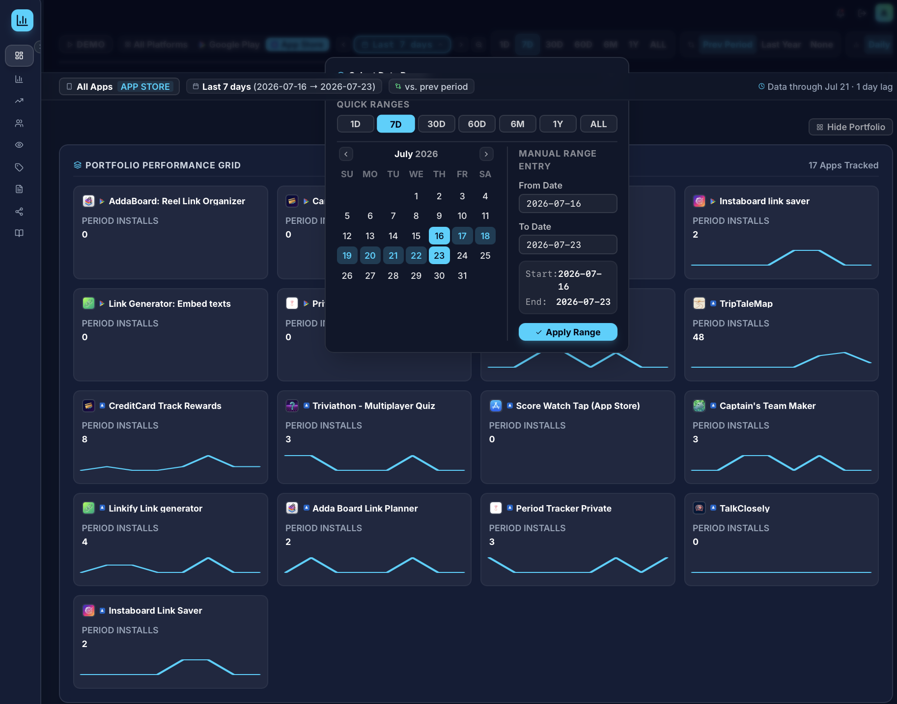

> **Live Demo**: Try the interactive web dashboard instantly: **[AppRankly Live Demo](https://zmsp.github.io/AppRankly/#demo)** *(Running in simulated demo mode with sample data)*  
> **Links**: [GitHub Repository](https://github.com/zmsp/AppRankly) | [Apps Directory](https://apps.shahadat.us/apps/apprankly/) | [Unraid Store](https://ca.unraid.net/apps/apprankly-1bdjnw60t14ouy)

# AppRankly

**AppRankly** is an open-source, self-hosted dashboard built to simplify how you track your mobile apps. Instead of jumping back and forth between developer consoles, AppRankly pulls data directly from Google Cloud Storage (Google Play) and the App Store Connect API to give you a single, clean overview of your app performance.

It also includes a built-in AI assistant to help you optimize your App Store Optimization (ASO) strategy without relying on expensive monthly subscriptions.

## Key Features

* **Unified Dashboard**: View installs, uninstalls, active devices, and country stats for both Google Play and Apple App Store side by side.
* **Deep App Metrics**: Zoom into individual app trends, track version adoption over time, and see detailed geographic breakdowns.
* **AI-Powered ASO Studio**: Discover keyword ideas using live store autocomplete data, run listing health checks, and draft metadata with OpenAI, Anthropic, or Gemini.
* **CLI & Automation**: Run background syncs, export raw reports, or trigger daily updates using standard cron jobs.
* **Easy Deployment**: Run it anywhere using Docker Compose, or install it directly via [Unraid Community Applications](https://ca.unraid.net/apps/apprankly-1bdjnw60t14ouy).

## Screenshots



## Tech Stack

* **Frontend**: HTML5, Vanilla CSS3, JavaScript (Lightweight SPA)
* **Backend**: Node.js & Express REST API
* **AI Integrations**: OpenAI, Anthropic (Claude), and Google Gemini
* **Deployment**: Docker, Docker Compose, GHCR, Unraid CA
