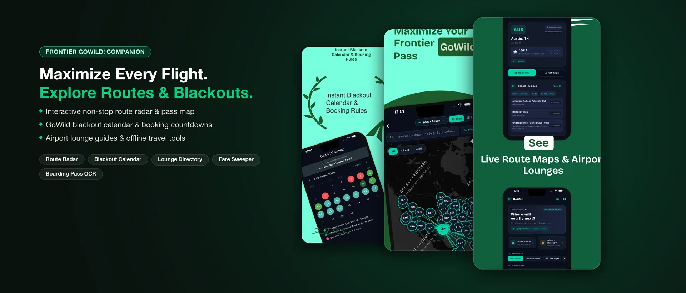

The GoWild! pass rules are honestly confusing. Domestic flights only open up 1 day before departure, international ones open 10 days out, and there are blackout dates scattered throughout the year. I kept second-guessing myself every time I wanted to book.

So I built **Frontier Helper** to keep track of all that for me. It shows available routes, the booking window calendar, and lets me pull up my boarding pass QR without digging through emails.

## Key Features

* **GoWild! Route & Flight Finder**: Discover eligible Frontier routes across North America and Latin America, and search available flights from your home base airport.
* **Booking Window & Blackout Calendar**: Track domestic (0–2 days) and international (0–11 days) booking windows alongside official GoWild blackout dates on an interactive calendar.
* **Traveler Pass & Boarding Pass Wallet**: Save Frontier IDs, TSA PreCheck numbers, and scan or crop boarding pass QR codes securely right on your device.
* **Live Flight Status Lookup**: Check real-time ADS-B telemetry, squawk codes, flight status, and route maps for your saved flights.
* **100% On-Device & Private**: All profile details, saved flight data, and boarding pass scans stay stored locally on your device.

## Screenshots



## Tech Stack

* **Frontend**: Flutter & Riverpod
* **Data & Storage**: SQLite & On-Device Caching
* **Flight Data**: ADS-B Telemetry & Route Graph Engine
* **Platforms**: iOS (iPhone & iPad) & Android
