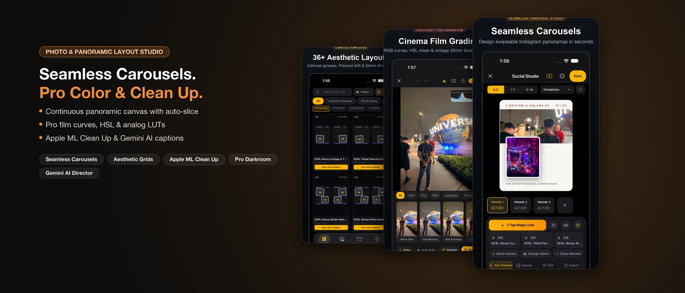

Posting a panorama to Instagram is kind of a pain. You either crop it down to one frame and lose most of it, or you try to split it manually and the alignment is always slightly off. I also wanted darkroom-style color editing without uploading my photos to some random service.

**Cutr** handles both. It slices panoramas into aligned carousel slides, has a full tone curves and HSL color editor, and can pull photos directly from a self-hosted Immich server. Everything stays local.

## Key Features

* **Seamless Panoramic Carousels**: Slice wide panoramic shots into perfectly continuous 1:1, 4:5, or 9:16 multi-slide sequences with live seam guide overlays and feed grid previews.
* **Aesthetic Templates & Story Layouts**: Curated 1:1 square presets and 9:16 story layouts with 35mm film frames, retro borders, and minimalist EXIF camera specification tags.
* **Lightcraft Photo Darkroom**: Professional-grade color editing featuring interactive Tone Curves for RGB and individual channels, complete HSL mixer, 3-way color wheels, real-time histogram, and a before/after split comparison slider.
* **AI Director & Smart Captions**: Generate creative social captions and relevant hashtags tailored to your layout composition using Google Gemini AI.
* **Local-First & Immich Integration**: Works 100% offline with local media, or connects directly to your self-hosted Immich server to edit and export without downloading your entire photo library to your phone.

## Screenshots



## Tech Stack

* **Framework**: Flutter & Riverpod
* **Database**: Drift (SQLite) with reactive query streams
* **Photo Engine**: Lightcraft high-performance image processing pipeline
* **AI Integration**: Google Gemini API
* **Self-Hosting**: Immich REST API client
* **Platforms**: iOS (iPhone & iPad) & Android
